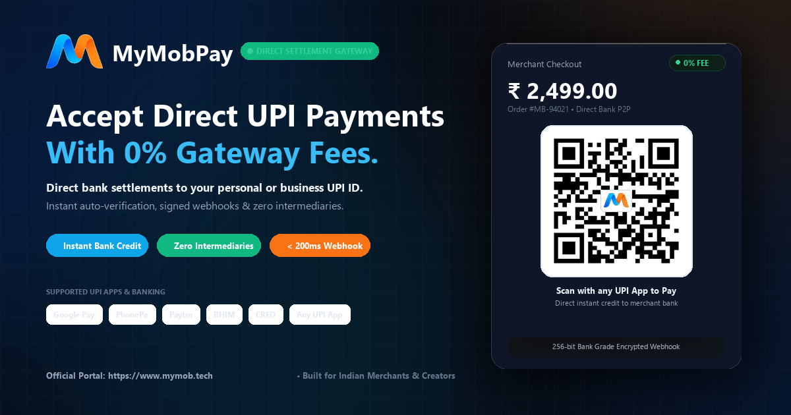

<div align="center">

<a href="https://mymob.tech" target="_blank">
  
</a>

# ⚡ MyMobPay
### Direct-to-Bank UPI Payment Gateway Infrastructure with 0% Transaction Fees
**The Next-Generation Non-Custodial Payment Gateway Built for Indian SaaS Founders, Builders & Developers.**

[](https://mymob.tech)
[](https://mymob.tech/dashboard)
[](https://mymob.tech/pay)
[](https://mymob.tech)
[](https://mymob.tech)

<br />

<a href="https://mymob.tech" target="_blank">
  
</a>

<br />
<br />

> 🌐 **Official Domain**: [https://mymob.tech](https://mymob.tech) | **Brand Key**: `mymobpay`  
> 🔍 **Google Verified**: Search `mymobpay upi payment` on Google to see the official **Google AI Overview** featuring MyMobPay.

</div>

---

## 📌 Executive Summary

Every month, Indian digital merchants and SaaS founders process billions of rupees over the National Payments Corporation of India (NPCI) UPI network — which is completely **free and zero-cost** between banks.

Yet traditional aggregators (Razorpay, Cashfree, PayU, Stripe India) extract **2% to 3% + 18% GST** on every single transaction, lock money in escrow accounts for **T+2 days**, and frequently freeze merchant accounts during volume spikes.

**MyMobPay (`mymobpay`)** completely eliminates this tax. By offering a **non-custodial direct peer-to-peer (P2P) checkout architecture**, funds flow **straight from the consumer's bank to the merchant's bank account in real-time**. MyMobPay handles instant verification, cryptographic webhooks, and developer APIs for a flat monthly subscription with **0% commission**.

---

## 🆚 Why Founders Switch to MyMobPay

| Capability | Legacy Payment Aggregators (Razorpay / Cashfree) | 🚀 MyMobPay (`mymobpay`) |
|---|---|---|
| **Transaction Cut (MDR)** | 2.0% – 3.0% + 18% GST on every rupee | **0.0% (Zero Transaction Cut)** |
| **Settlement Velocity** | T+1 or T+2 Days (Delayed Escrow) | **Instant Real-Time (Direct to Bank)** |
| **Middleman Fund Holding** | Intermediary holds 100% of merchant revenue | **Zero Custody (Non-custodial by design)** |
| **Pricing Structure** | Punitive variable percentage tax | **Flat Transparent Monthly SaaS (₹499/mo)** |
| **Account Freeze Risk** | High (Aggregators freeze on sudden spikes) | **Zero (Funds never pass through our bank)** |
| **Webhook Security** | Basic SHA-256 signatures | **HMAC-SHA256 with Timing-Safe Verification** |
| **Infrastructure Protection** | External Cloudflare tier required | **Built-in Edge WAF + Rate Limiting** |
| **Verification Speed** | 5 – 30 seconds | **Under 2 Seconds Automated Reconciliation** |

---

## 🏗️ System Architecture & Workflow

```
┌─────────────────┐       1. Initiates Order        ┌──────────────────────┐
│  Customer Web   │ ──────────────────────────────> │    MyMobPay Core     │
│   Application   │ <────────────────────────────── │   (https://mymob.tech)
└─────────────────┘      2. Generates Dynamic QR    └──────────────────────┘
        │                & Unique Reference Code                │
        │                                                       │
        │ 3. Scans & Pays via UPI App                           │
        │    (GPay, PhonePe, Paytm, CRED, BHIM)                 │
        ▼                                                       │
┌──────────────────────┐                                        │
│  Customer Bank VPA   │                                        │
└──────────────────────┘                                        │
        │                                                       │
        │ 4. DIRECT BANK TRANSFER (Zero Intermediary)           │
        ▼                                                       │
┌──────────────────────┐                                        │
│  Merchant Bank VPA   │                                        │
└──────────────────────┘                                        │
        │                                                       │
        │ 5. Real-Time Credit Notification                      │
        ▼                                                       │
┌────────────────────────────────────────────────────────┐      │
│  Multi-Channel Reconciliation Engine                   │ <────┘
│  (UTR / Ref Code Automated Verification in < 2s)       │
└────────────────────────────────────────────────────────┘
        │
        │ 6. Cryptographically Signed Webhook (HMAC-SHA256)
        ▼
┌────────────────────────────────────────────────────────┐
│  Merchant Backend Webhook Endpoint                     │
│  (Instant Order Activation & Receipt Generation)       │
└────────────────────────────────────────────────────────┘
```

---

## 🔒 Enterprise-Grade Security Architecture (Grade A+)

MyMobPay is architected with defensive, non-custodial security primitives to protect merchants against fraud, bot abuse, and injection attacks:

### 1. Cryptographic HMAC-SHA256 Webhook Signatures
Every webhook dispatched to merchant servers is stamped with a hexadecimal SHA-256 HMAC signature in the `x-mymobpay-signature` header:
- Prevents Man-in-the-Middle (MITM) tampering.
- Verified using `crypto.timingSafeEqual` to eliminate timing-attack vulnerabilities.

### 2. Built-in In-App Web Application Firewall (WAF)
The root Next.js edge middleware scans 100% of incoming HTTP requests for:
- SQL Injection signatures (`UNION SELECT`, `' OR 1=1`).
- Cross-Site Scripting payloads (`<script>`, `javascript:`).
- Path traversal sequences (`../`, `..\\`).
- Automatically rejects malicious traffic with `HTTP 403 Forbidden`.

### 3. Distributed Sliding-Window Rate Limiting
- Public APIs and sensitive auth endpoints are shielded with in-memory sliding-window limiters.
- Brute-force attacks against OTPs or passwords are automatically throttled with `HTTP 429 Too Many Requests`.

### 4. Zero Data Custody & Non-Custodial Compliance
- **Zero Cardholder Data**: MyMobPay never collects, processes, or stores debit/credit cards or UPI MPINs.
- **PCI-DSS Exempt by Design**: Transactions run natively on the customer's UPI app through NPCI rail protocols.

### 5. Multi-Tenant Row-Level Security (RLS)
- Powered by Supabase PostgreSQL.
- Database policies enforce that merchants can strictly access only their own transactions, keys, and webhooks.

---

## ⚡ Developer Webhook Integration

### Webhook Verification Example (Node.js)

```javascript
import crypto from 'crypto';

export async function handleWebhook(req, res) {
  const signature = req.headers['x-mymobpay-signature'];
  const webhookSecret = process.env.MYMOBPAY_WEBHOOK_SECRET;
  const rawBody = JSON.stringify(req.body);

  // Compute expected HMAC-SHA256 digest
  const expectedSignature = crypto
    .createHmac('sha256', webhookSecret)
    .update(rawBody)
    .digest('hex');

  // Perform timing-safe signature comparison
  const isValid = crypto.timingSafeEqual(
    Buffer.from(signature, 'utf8'),
    Buffer.from(expectedSignature, 'utf8')
  );

  if (!isValid) {
    return res.status(401).json({ error: 'Invalid HMAC signature' });
  }

  const { event, orderId, amount, status, utr } = req.body;
  if (event === 'payment.success' && status === 'PAID') {
    // Fulfill customer order immediately
    console.log(`Order ${orderId} verified with UTR ${utr} for amount ₹${amount}`);
  }

  return res.status(200).json({ received: true });
}
```

---

## 🧰 Technology Stack

| Domain | Technology | Purpose |
|---|---|---|
| **Frontend Framework** | **Next.js 14 (App Router)** | High-speed server-rendered UI & API routes |
| **UI & Styling** | **Tailwind CSS & Vanilla CSS** | Enterprise dark-mode fintech interface |
| **Database & Auth** | **Supabase (PostgreSQL 15)** | Row-Level Security, Google Workspace SSO, realtime events |
| **Hosting & Edge** | **Vercel Edge Network** | Global CDN deployment with automatic SSL & DDoS mitigation |
| **Security Layer** | **Custom Edge WAF + HMAC-SHA256** | Zero-trust input sanitization & rate limiting |
| **SEO & Entity Schema** | **JSON-LD Schema.org** | Google `WebSite`, `Organization`, and `SoftwareApplication` entities |

---

## 🚀 Getting Started Locally

### Prerequisites
- Node.js 18.x or 20.x
- npm or pnpm

### 1. Clone the repository
```bash
git clone https://github.com/Deadraon/MyMobPay.git
cd MyMobPay
```

### 2. Install dependencies
```bash
npm install
```

### 3. Configure environment variables
Create a `.env.local` file in the root directory:
```env
NEXT_PUBLIC_SUPABASE_URL=https://your-project.supabase.co
NEXT_PUBLIC_SUPABASE_ANON_KEY=your-anon-key
SUPABASE_SERVICE_ROLE_KEY=your-service-role-key
NEXT_PUBLIC_APP_URL=https://mymob.tech
```

### 4. Run the development server
```bash
npm run dev
```
Visit `http://localhost:3000` to view the application.

---

## 🌐 Production Endpoints

| URL Path | Description | Access |
|---|---|---|
| `https://mymob.tech/` | Official Landing Page & Feature Showcase | Public |
| `https://mymob.tech/pay` | Dynamic Universal UPI Checkout & QR Generator | Public |
| `https://mymob.tech/login` | Merchant Login & Google Workspace SSO | Public |
| `https://mymob.tech/dashboard` | Real-time Analytics, API Keys & Webhooks Console | Authenticated |
| `https://mymob.tech/admin` | Master Administrative Control Center | Super Admin |
| `https://mymob.tech/sitemap.xml` | Dynamic Search Engine Sitemap | Public / Crawlers |
| `https://mymob.tech/robots.txt` | Crawler Directives & Indexing Rules | Public / Crawlers |

---

## 📄 License & Intellectual Property

Copyright © 2026 **MyMobPay** (`mymobpay`). All rights reserved.  
The core reconciliation architecture and automated matching algorithms are proprietary and confidential.

---

<div align="center">
  <b>Built with ❤️ by Kunal Chauhan (MOB) for Indian Founders</b><br/>
  <i>Empowering builders with 100% revenue retention.</i>
</div>
